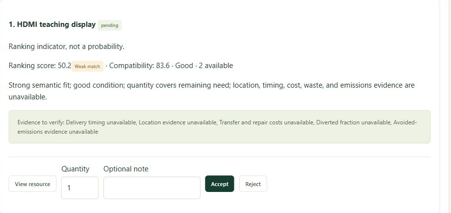
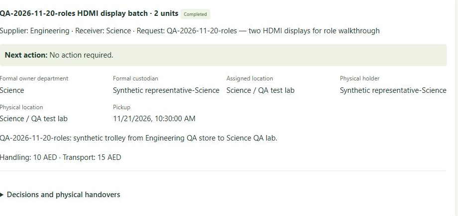
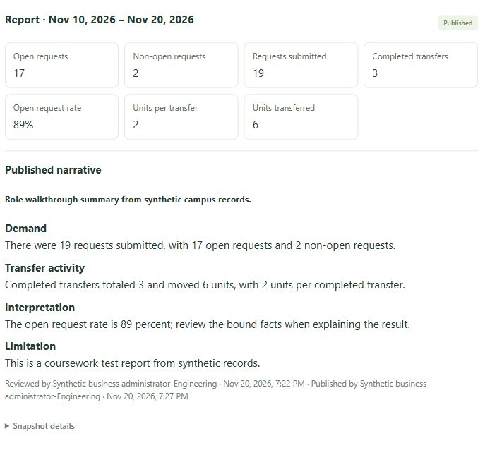

# Phase 6 Implementation Report

## Circular Campus Resource Exchange and Asset Management

COSC 336 Introduction to Software Engineering | Group 6 | Fall 2026

Version 1.0 | 22 November 2026 | Application baseline 514048c

Abi Ali Murtaza Ghadiyali — 100066653

Ahmed Mohamed Moustafa Ghandour — 100066431

Abdulrahman Feras Junaid — 100066011

Muhammad Awais Afzal Mirza — 100066617

### 1 Purpose and selected implementation

This report records the environment, selected features and verification of the Group 6 draft prototype. Phase 6 slide 5 requires at least the first six core features, AI features 2 and 5, and a report on the environment and selected features. That minimum is implemented in the repository. Section 5 distinguishes completed verification from remaining limits; full semester and production completion are not claimed.

The baseline is SRS v1.2 and Design v1.4. Selected scope is C1–C6, AI 2 matching and ranking, and AI 5 generated reports. C9 activity tables and CSV, and AI 4 conversational assistance, were subsequently added. C7 sustainability dashboard, C8 notifications, AI 1 classification, AI 3 action advice, maintenance and end of life remain deferred. Nine role classes are retained with milestone appropriate workflows. [R1–R3]

### 2 Implementation environment

| Area                   | Implemented choice and purpose                                             |
| ---------------------- | -------------------------------------------------------------------------- |
| User interface         | React 19, TypeScript and Vite 7 for reusable browser screens               |
| Managed backend        | Supabase Auth, PostgreSQL, row level security and transaction functions    |
| Matching               | pgvector and 384 dimensional gte-small embeddings in Supabase Edge Runtime |
| Generated language     | Server side Gemini calls through Supabase Edge Functions                   |
| Hosting                | Cloudflare Pages frontend; GitHub source control and CI                    |
| Development and checks | Node.js 22 baseline, Vitest, PGlite, Playwright and native PostgreSQL CI   |

The managed backend architecture is retained. React screens call service classes; PostgreSQL enforces permissions and commits business mutations with audit records. Gemini credentials stay on the server. The browser uses public project configuration and the signed in user's session. Abdulrahman reported instructor stack approval on 8 November. All demonstration records are synthetic coursework data. [R2–R4]

<!-- pagebreak -->

### 3 Core functionality and approval rules

| ID  | Implemented behavior                                                                                                                                                        |
| --- | --------------------------------------------------------------------------------------------------------------------------------------------------------------------------- |
| C1  | Login and active account checks, nine role keys and backend authorization. Technical account administration does not grant business approval.                               |
| C2  | Department linked assets record category, condition, status and location. Tracked assets and batch StockPortions preserve quantity and custody.                             |
| C3  | Representatives publish surplus separately from registration. Users search by keyword and filter by category, condition and department within their scope.                  |
| C4  | Staff submit requests and track requested, accepted, allocated and remaining quantities. Request records remain permission scoped.                                          |
| C5  | Selection creates an Interest. Supplier reservation and release are separate decisions; self approval is rejected. Facilities dispatches and the receiver confirms receipt. |
| C6  | Guarded transitions reject invalid actions. History records actor, time and reason, subject to access and financial redaction rules.                                        |

Registration does not automatically publish an asset, and Interest does not reserve it. Reservation locks request and stock records in a database transaction to prevent double allocation. Partial allocation splits a homogeneous portion into conserved quantities. Expected versions and stable operation keys reject stale updates and prevent duplicate outcomes on retries. [R4]

Physical movement and formal custody are separate. Dispatch updates physical tracking; full suitable accepted receipt changes formal department, custodian and assigned location. A short or unsafe receipt remains Disputed and allocated. The receiver can reconcile and accept the full quantity, or the supplier can confirm physical return. Returned unsafe stock remains Unfit; cancellation cannot silently restore unsafe stock to circulation. [R4, R5]

Backend checks enforce active roles, departmental boundaries, assigned Facilities authority and separation of requester and approver. Values and costs are redacted according to explicit permissions, including nested history. Ordinary users cannot call private database helpers or rewrite audit history. AI advice never grants authority to reserve, release or receive stock. [R4–R6]

The interface provides item appropriate illustrations, compact asset records, expandable history and reachable account controls. Long records and small screens retain scrolling for access. Request drafts survive navigation in memory for the current user; submission or account change clears them. Failed catalogue loads show an unavailable state and retry action. [R6]

<!-- pagebreak -->

### 4 AI functionality and human decisions

#### AI 2 Matching and ranking

The authenticated gateway checks a request, retrieves authorized candidates and returns up to five eligible surplus portions with scores, a reason and missing evidence warnings. Suitability gates run before ranking. Embeddings use gte-small with 384 dimensions; Gemini does not create these vectors. Requesters can accept or reject suggestions. Acceptance records selection through the Interest workflow and still requires supplier approval. [R7]

Compatibility combines semantic similarity at 65%, condition at 15%, quantity at 10% and location at 10%. Final rank weights functional compatibility at 60%, timing at 15%, cost at 10%, diversion at 10% and carbon benefit at 5%. Eligible candidates already pass the minimum condition gate. Missing location, timing, cost, waste and emissions evidence contributes zero with explicit warnings; weights are not redistributed. Strong semantic fit can therefore produce a modest final score. Scores are ranking indicators, not probabilities or measured AI accuracy. [R7]

Conventional search and manual selection remain available during matching failure; local tests cover this fallback. The 20 November hosted walkthrough observed five real recommendations and explanations but did not submit Accept or Reject. Recommendation decisions and embedding freshness remain team rehearsal checks. [R5, R6]

#### AI 5 Generated reports

PostgreSQL captures a frozen snapshot for a selected period and scope. The database calculates figures; Gemini writes a short narrative from those facts. Validation rejects unsupported numeric claims. A business administrator edits the draft, marks it Ready and explicitly publishes it. Ordinary readers see Published content without editing or publication controls. Facts remain available during narrative generation failure. Numeric validation supports human review of the wording. [R5, R8]

The hosted 10–20 November synthetic snapshot contained 19 submitted requests, 17 open, 2 non open, 3 completed transfers and 6 transferred units. An invented total of 999999 was rejected. A valid edit was reviewed, published with authorization and read through the Sustainability account. These are historical snapshot values, not current live totals or actual campus outcomes. [R5]

#### Additional implemented features

C9 provides scoped request and transfer tables and CSV export. Costs are omitted and spreadsheet formula injection is guarded. AI 4 answers scoped catalogue and own request questions or prepares an unsubmitted request draft. It refuses approval and transfer commands; the user confirms through normal forms. These additions do not implement deferred specialist workflows. [R4, R6]

<!-- pagebreak -->

### 5 Verification and remaining limits

| Evidence                                    | Result and boundary                                                                                                                                                           |
| ------------------------------------------- | ----------------------------------------------------------------------------------------------------------------------------------------------------------------------------- |
| Refreshed locally on 22 November            | 227 unit tests in 19 files; 57 PGlite SQL checks and AI 2 SQL contract assertions passed. Type check and build passed. Existing chunk size warning remains.                   |
| Browser regressions recorded on 21 November | 24 journeys passed with synthetic Auth and HTTP or local SQL adapters, including custody, privacy, retry, outage, draft, report and CSV checks.                               |
| Native PostgreSQL evidence                  | Repository CI separately covers workflow SQL, overlapping transaction races and AI 2 pgvector. This documentation run did not repeat that suite.                              |
| Hosted walkthrough on 20 November           | All nine roles exercised; labelled transfer completed through dispute and reconciliation. Live matching and report generation, editing, publication and reader view observed. |
| Abi's hosted closure confirmation           | Issue 23 is closed. Abi recorded migration 202611210001 applied, correct selection note visibility, outsider denial, restricted costs/history and normal workflow loading.    |

PR 25 fixes stale assistant responses across account changes, typed specification corruption, misleading catalogue outage states, missing supplier selection notes and lost request drafts. Local regressions cover these fixes. Abi's issue comment supplies hosted selection note acceptance evidence; no hosted database changes were performed while preparing this report. [R6, R9]

The dedicated hosted scenario published four synthetic HDMI displays in Engineering and requested two for Science. After approval and dispatch, receipt of only one caused a dispute while formal custody stayed in Engineering. Reconciled acceptance completed the transfer: requested 2, accepted 2, allocated 0, remaining 0. Two units remained in Engineering. A separate local return check kept Poor returned stock Unfit. [R5]

Remaining checks are hosted CSV contents; recommendation accept and reject and fresh embeddings; precise deployed AI function versions and timeout behavior; and hosted replay of all PR 25 regressions. The CSV browser tool timed out after initiating export, while the local CSV journey passed. Current source contains the AI 5 timeout and corrected AI 4 handler, but frontend deployment does not establish hosted function versions. [R6, R8, R9]

The team must review this report, explain contributions and rehearse. No general relevance benchmark, production certification, hosted restore exercise or real sustainability benefit is claimed. Test records remain synthetic. Closing issue 23 settles its migration defect, not all remaining acceptance checks. [R5, R9]

<!-- pagebreak -->

### 6 Selected hosted evidence

These excerpts are from 20 November and show the earlier interface. They document observed behavior, not the exact appearance of the latest frontend. Full captures and role results remain in the repository. [R5]

Figure 1. One of five recommendations with scores, missing evidence and human controls. Accept and Reject were observed but not submitted in this walkthrough.

Figure 2. Two unit transfer after reconciled acceptance. Science custody and synthetic costs appear in the authorized receiving representative's view.

<!-- pagebreak -->

### 7 Published report and team responsibilities

Figure 3. Published reader excerpt with database facts and a human reviewed synthetic narrative. Publication is inside the app, not a coursework upload. [R5]

| Team member    | Recorded implementation ownership                                                                |
| -------------- | ------------------------------------------------------------------------------------------------ |
| Abdulrahman    | Foundation, accounts, catalogue and audit groundwork; subsequent integration and audit follow up |
| Ahmed          | Requests, reservations, releases, transfers and history; C9 and AI 4 assistant                   |
| Abi Ali        | AI 2 matching and ranking; hosted migration and acceptance in issue 23                           |
| Muhammad Awais | AI 5 snapshot, narrative review and publication; reporting and integration                       |

AI assistance was used during implementation, documentation and test preparation. Automated checks and assistant run walkthroughs are identified above. Each member must review the report, verify their contribution description and explain the code and design choices. Personal understanding and rehearsal are not claimed as completed by preparing this document.

#### References

[R1 Phase 6 slides 3 to 5](https://github.com/Abiali1210/ai-campus-resource-exchange-and-asset-management-Group-6/blob/main/docs/phase-6/sources/phase-6-draft-implementation.pptx) · [R2 SRS v1.2](https://github.com/Abiali1210/ai-campus-resource-exchange-and-asset-management-Group-6/blob/main/docs/phase-3/COSC336_Group6_Phase3_SRS_v1.2.docx) · [R3 Design v1.4](https://github.com/Abiali1210/ai-campus-resource-exchange-and-asset-management-Group-6/blob/main/docs/phase-4-5/COSC336_Group6_Phase4_5_Design_v1.4.docx)

[R4 Workflow handoff](handoffs/02-ahmed.md) · [R5 Hosted walkthrough and full captures](reviews/2026-11-20/hosted-role-walkthrough.md) · [R6 Audit fixes and regressions](handoffs/06-audit-fixes.md)

[R7 Matching contract](../../supabase/functions/ai2-match/README.md) · [R8 Report implementation and review](handoffs/04-ai5-review-and-additions.md) · [R9 Abi's hosted closure confirmation](https://github.com/Abiali1210/ai-campus-resource-exchange-and-asset-management-Group-6/issues/23#issuecomment-7070239791)
