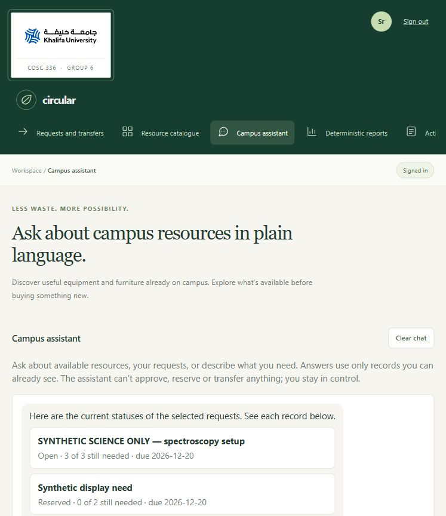
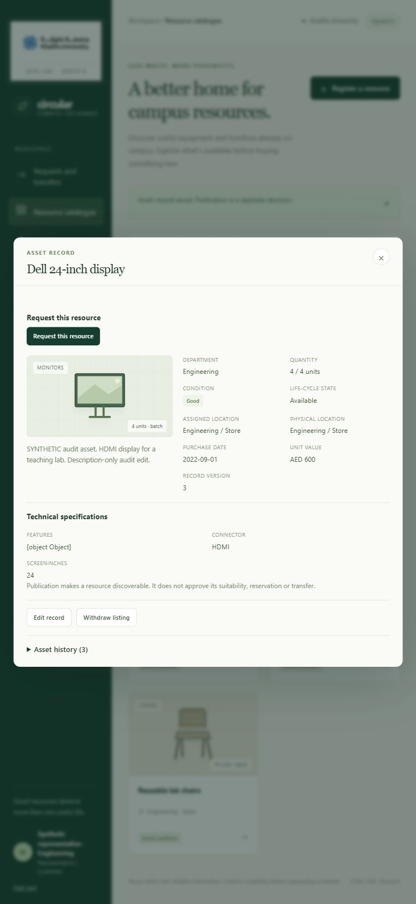
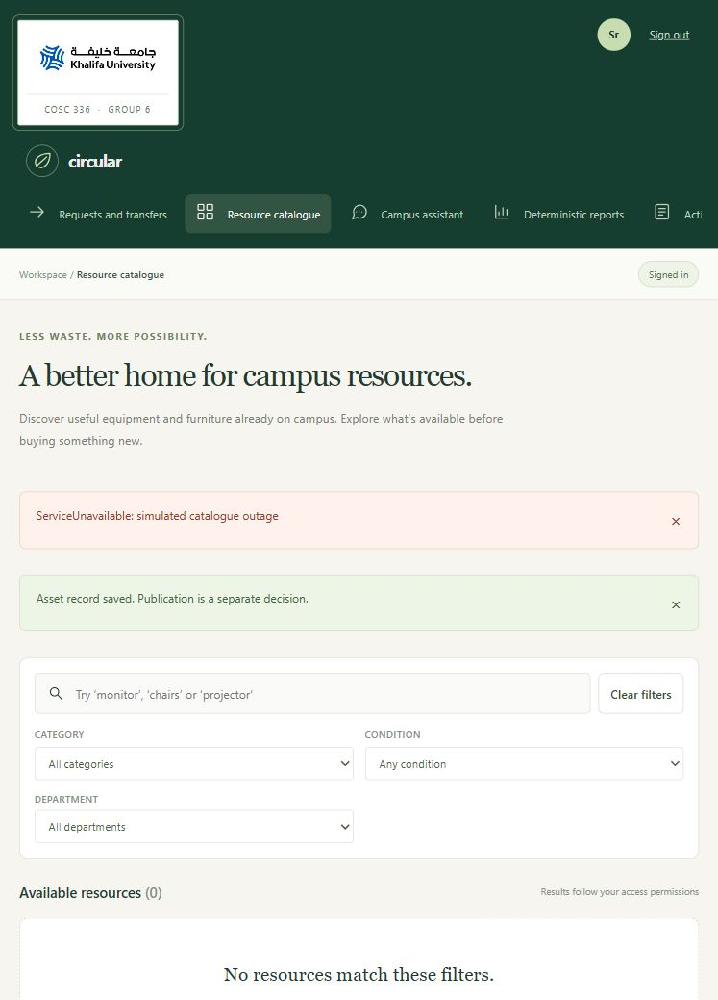
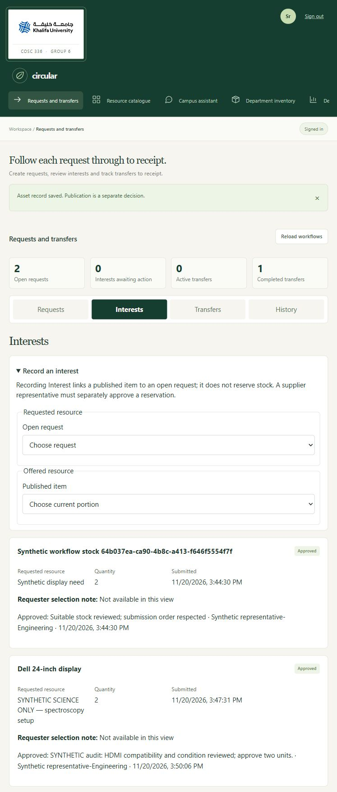
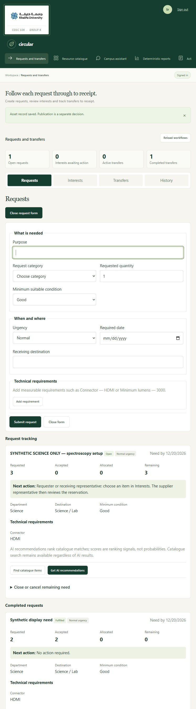

# Phase 6 exploratory usability audit — 20 November 2026

**Later verification:** Abdulrahman subsequently authorized hosted testing. The [hosted walkthrough of all nine roles](hosted-role-walkthrough.md) adds actual live-account results, a completed hosted transfer, live matching/report generation and published reader verification. The limitations below describe this earlier local run; use the addendum for current combined coverage.

Reviewed checkout: `codex/phase6-integration-polish`, commit `34dd433d18f82aa22725adc7d079995fa180c8a1` (draft PR #24). This report records observed behavior; it does not implement the proposed fixes or certify the hosted application.

Verification after the walkthrough: all **224 existing unit tests across 18 files passed**. The audit Markdown was formatted and all eight linked screenshots were checked to exist. Application source files were unchanged. Passing existing tests does not cover the newly reproduced scenarios below. The disposable local server was stopped after testing. See PR #24 and issue #23 for subsequent publication, merge and deployment status.

## Scope and evidence limits

The application was operated through its browser interface, using disposable synthetic accounts and a fresh in-memory PGlite database containing the repository's foundation, workflow and reporting migrations. SQL inspection confirmed the saved specification types and final request quantities. The frontend and business SQL were real; the localhost authentication adapter and AI responses were synthetic. No shared Supabase data, real passwords, remote deployments or purchases were used.

The audit covered requester accounts in Science and Engineering, representatives in both departments, Facilities, Business Administrator, System Administrator and Sustainability Officer. Finance, Procurement and Maintenance were not separately walked through. Browser width was approximately 747px for the normal side-panel view and explicitly 390 × 844 for the phone view. Keyboard checks covered modal entry, history expansion, Escape and returned focus. This is exploratory coverage, not an exhaustive accessibility or security assessment.

Important exclusions:

- Hosted verification remains assigned to the team, as requested.
- Successful AI #2 ranking was unavailable because the disposable adapter does not provide native pgvector. Its unavailable/manual-search path was exercised. This is a test-environment limitation, not a newly discovered application failure.
- Synthetic AI #4/#5 responses verify the surrounding workflow, not Gemini quality, relevance or production response time.
- A new request reached the human review form, but browser date entry did not populate the required field. Pickup scheduling had the same tool limitation. These submissions were **not** counted as completed browser checks. An existing SQL-created in-transit fixture was used for receipt testing.
- CSV export was attempted, but browser download permission was declined. No workaround was used; downloaded CSV contents remain unverified in this audit.
- Competing reservations, supplier-confirmed returns, stale concurrent tabs and exhaustive account administration remain follow-up checks. Previously passing automated checks are not substitutes for these missing hands-on checks.

## Priority and ownership proposal

Assignments below are suggestions for review, not messages sent to teammates. All fixes remain unimplemented by this audit.

| ID  | Priority       | Observed problem                                                         | Suggested owner              | Recommendation                                            |
| --- | -------------- | ------------------------------------------------------------------------ | ---------------------------- | --------------------------------------------------------- |
| A1  | P1 — high      | A delayed assistant reply survives logout and appears in another account | Muhammad Awais + Abdulrahman | Fix before a shared-device demonstration or release       |
| A2  | P2 — important | A description-only asset edit corrupts structured specification values   | Abdulrahman                  | Fix before entering or editing representative data        |
| A3  | P2 — important | Catalogue outage becomes an apparent empty search result                 | Abdulrahman                  | Fix before the demonstration; recovery should be explicit |
| A4  | P2 — important | The supplier cannot see the requester's required selection note          | Ahmed + Abdulrahman          | Restore narrowly scoped decision context                  |
| A5  | P2 — usability | Leaving an unfinished request silently discards its edits                | Abdulrahman                  | Preserve the draft or warn before navigation              |

P1 means a high-impact problem in the demonstrated scenario. P2 means a real defect or substantial usability problem that should be scheduled. These labels do not imply that every scenario has been tested on the hosted site.

## A1 — Assistant reply crosses a login boundary

**Reproduction**

1. Sign in as the Science requester, who has a request titled `SYNTHETIC SCIENCE ONLY — spectroscopy setup`.
2. Ask “What's the status of my requests?” with a deliberately delayed response (15 seconds in this test, within the handler's timeout).
3. Sign out while the answer is pending, then sign in as the Engineering requester in the same tab.
4. Open Campus assistant and allow the original response to finish.

**Observed:** The sidebar identifies the Engineering requester, but the assistant displays the Science request title, status, remaining quantity and due date. The Engineering account's ordinary workflow view shows its own request instead. The delayed response was captured under the original Science caller, so this is stale client state crossing sessions, not the test backend querying as the wrong caller.

**Expected:** Logout invalidates every pending response from that session. The new account starts with its own conversation and records.

**Cause:** `src/AssistantPanel.tsx:49–79` appends the awaited result through a setter owned by App. `src/App.tsx:1337–1347` clears existing messages on logout, but the old asynchronous callback can append afterward. Unmounting the panel does not invalidate that callback. Resource selection and success notices also persisted across sign-ins; the assistant record disclosure is the material consequence.

**Smallest safe direction:** Bind response acceptance to a session/user generation, invalidate it immediately on logout/account change, and discard both stale success and error callbacks. Aborting work is useful but should not be the only guard. Reset other account-bound selections and notices at the same boundary.

**Regression checks:** Same-account normal reply; logout before success; logout before error; account switch; navigation away while pending; two overlapping requests returning out of order. Only the current session may update its messages.

## A2 — Saving unrelated edits changes specification data

**Reproduction**

1. Use an authorized representative and an asset whose specifications contain a number and object: `{"connector":"HDMI","screenInches":24,"features":{"heightAdjustable":true}}`.
2. Open Edit record, change only Description, and save.
3. Reopen the asset and inspect its stored specifications.

**Observed:** The object became the literal string `[object Object]`; the number `24` became the string `"24"`. SQL confirmed both saved types were `string`. The asset record version advanced, so the damaged metadata was persisted.

**Expected:** An unchanged specification retains its original value and type.

**Cause:** `src/App.tsx:370–372` converts every non-string value with `String(value)` when building editor rows. Saving reconstructs the specifications from those strings at `src/App.tsx:394`. The `AssetView` contract permits unknown JSON values, and the database accepts JSON objects. Suitability uses JSON containment (`workflow_suitable`), which distinguishes numbers from strings; therefore this can affect matching as well as display.

**Smallest safe direction:** Preserve original typed values for untouched rows. Either support explicit typed editing or make structured values read-only in this simple editor. Avoid adding a generic JSON editor unless the team needs it.

**Regression checks:** Description-only edit preserves numbers, booleans, arrays and nested objects; ordinary string specifications remain editable; removing an explicitly selected specification still works.

## A3 — Catalogue failure is presented as “no resources”

**Reproduction**

1. Make a catalogue request fail (a temporary service outage was injected locally).
2. Open the catalogue.
3. Dismiss the error banner.

**Observed:** The page shows `Available resources (0)` and “No resources match these filters” with advice to broaden the search. After dismissing the banner, only that misleading empty-result state remains. There is no explicit Retry control. The initial raw error wording in the screenshot comes from the injected failure; the defect is the application rendering an empty-success state for a failed load.

**Expected:** A failed request has a distinct unavailable state and a retry action. Zero results should mean a successful search returned zero accessible records.

**Cause:** `src/App.tsx:1289–1290` empties the asset list on failure. The result heading and empty-state branch near `src/App.tsx:1977` and `2027` then render normally without a separate load-failure status.

**Smallest safe direction:** Track catalogue status separately from the global dismissible notice; render a retryable failure state. If retaining previous results, clearly identify them as potentially stale and keep server-side guards on all actions.

**Regression checks:** First-load failure; failed search after successful results; dismissing a banner; retry success; a genuine successful zero-result search.

## A4 — Supplier decision loses the requester's selection note

**Reproduction**

1. As Science requester, record an interest in the Engineering display with a selection note, such as “inspected HDMI compatibility; need two initially.”
2. Sign in as Engineering representative and open Interests to review the pending reservation.

**Observed:** The supplier can approve/reject the reservation but sees `Requester selection note: Not available in this view`. The requester can see the note. This was observed before approval and again in the retained decision record.

**Expected:** A supplier authorized to review that interest can read the selection reason relevant to their decision, without gaining unrelated request history or financial data.

**Cause:** `src/WorkflowPanel.tsx:1461–1472` derives the note from audit history. `interest.recorded` is stored as a request audit event (`202611090001_workflows.sql:207`), while the workspace's request-history filter requires write access (`202611090002_workflow_financial_redaction.sql:83`). Cross-department suppliers have appropriate read access for the interest but not write access to the request.

**Smallest safe direction:** Project the selection reason into each permitted interest through a narrowly scoped field. Keep the existing restrictions on unrelated audit events and cost information; do not broaden access to all request history.

**Regression checks:** Creator, receiver representative and supplier see the relevant note; an unrelated department cannot see the interest/note; financial redaction and technical/business separation remain intact.

## A5 — Navigation discards an unfinished request

**Reproduction**

1. Open a new request (also reproduced after opening an assistant-prepared draft).
2. Edit Purpose, category, quantity and Receiving destination without submitting.
3. Navigate to Resource catalogue, return to Requests and transfers, and reopen New request.

**Observed:** The fields return to empty/default values, with no warning before leaving. The edited assistant draft is not restored either. No request was submitted during this reproduction.

**Expected:** Keep the unfinished draft during ordinary navigation within the same session, or warn before losing edits. Do not carry a private draft into another account.

**Cause:** Form state is local to `WorkflowPanel` (`src/WorkflowPanel.tsx:605–611`), which unmounts on navigation. The initial assistant draft handoff is consumed and does not preserve later edits.

**Smallest safe direction:** Keep a single user-scoped draft in App, or implement a minimal dirty-form navigation confirmation. Persistent browser storage is unnecessary for this coursework fix.

**Regression checks:** Navigate away/back; close/reopen form; successful submit clears the draft; logout clears it; account switch never restores another user's draft.

## Further UI/UX improvements

These can follow the more important fixes; they are not reasons to redesign the application.

1. **Explain report structure validation accurately.** Replacing a generated draft with a number-free paragraph was rejected as “Narrative numbers must match the displayed snapshot facts.” The actual missing requirement was the five labelled sections. `src/Ai5ReportPanel.tsx:10–16` maps broad validation errors to a numbers message, while the SQL validator also requires `Headline`, `Demand`, `Transfer activity`, `Interpretation` and `Limitation`. Add clear structure guidance or five labelled fields, and distinguish structure errors from unsupported-number errors. Unsupported numbers were correctly rejected.
2. **Distinguish stock portions on catalogue cards.** After approving a partial batch and cancelling before dispatch, the two valid active portions appeared as visually identical “Dell 24-inch display” cards with two units, the same department, location and condition. This is not duplicate quantity accounting. Show a short portion reference or group same-asset portions so users can understand which quantity they are selecting.
3. **Use consistent time and role-aware copy.** Workflow cards showed local time (for example 15:44), while the activity table showed the same event as 11:44 without a timezone label (`src/c9Report.ts:12` slices the ISO timestamp). Label UTC or format consistently in Asia/Dubai. The report page also tells read-only roles to review/edit an AI draft although they can only read published reports. Prefer “Reports” or “Campus reports” over “Deterministic reports” in navigation. Old success notices persisted through several account changes; clear them at the session boundary as part of A1.

## Hands-on coverage and results

| Area / scenario                                                                 | Result in this audit                                                                                                                                                    |
| ------------------------------------------------------------------------------- | ----------------------------------------------------------------------------------------------------------------------------------------------------------------------- |
| Synthetic sign-in, sign-out and role-specific navigation                        | Exercised for the accounts listed above; stale client state found (A1)                                                                                                  |
| Catalogue keyword search and clear filters                                      | Search for extinguisher returned the correct single item; clearing restored the list                                                                                    |
| Item-specific illustrations                                                     | Fire extinguisher, display, chair and projector used their respective illustrations; category fallback for generic apparatus was visible                                |
| Asset record on a 390px phone viewport                                          | Fitted the width; document scroll width equalled client width (390px)                                                                                                   |
| Asset modal keyboard behavior                                                   | Initial close focus, Tab to history, Enter to expand, Escape to close, and focus return to the originating card worked                                                  |
| Asset registration                                                              | New synthetic projector record saved with its declared Poor condition and no invented value/date                                                                        |
| Publication                                                                     | Separate publication and withdrawal controls present; publication does not certify suitability. Poor condition alone was not treated as proof of an unsafe-state defect |
| Asset metadata editing                                                          | Description saved, but typed specification values corrupted (A2)                                                                                                        |
| Request human confirmation                                                      | Assistant produced an unsubmitted draft; user could edit it; date-required browser submission not completed                                                             |
| Interest selection                                                              | Requester recorded interest in two of four display units; no reservation was implied by interest alone                                                                  |
| Supplier reservation approval                                                   | Required reason entered; created a two-unit allocation and transfer; two units remained available                                                                       |
| Supplier release approval                                                       | Facilities assignee and reason recorded; status advanced to Approved; formal custody stayed with Engineering                                                            |
| Facilities scheduling                                                           | Form inspected; date entry blocked by browser tooling; not counted as submitted                                                                                         |
| Short receipt                                                                   | One of two units recorded; transfer became Disputed and remained allocated; formal custody stayed with Engineering; observed physical holder/location changed           |
| Reconciled acceptance                                                           | Full two-unit acceptance completed the transfer; formal department/custodian/location changed to Science; linked request became Fulfilled                               |
| Cancellation before dispatch                                                    | Different two-unit transfer cancelled; allocation removed; three-unit request returned to Open with remaining quantity three                                            |
| Final quantities                                                                | SQL confirmed Science need: accepted 0, allocated 0, remaining 3; Engineering need: 0/0/1; accepted fixture request: 2/0/0                                              |
| AI #2 unavailability                                                            | Friendly fallback and catalogue-search action remained available; real ranking not exercised                                                                            |
| Assistant data isolation                                                        | Delayed response after switching account exposed old session records (A1)                                                                                               |
| Activity report                                                                 | Scoped Science requests/transfers and completion/cancellation states matched the performed actions; requester/representative report omitted costs                       |
| Outcome breakdown                                                               | Three requests, two open, one fulfilled; one completed and one cancelled transfer; two accepted units. These matched the fixture and actions                            |
| Report permissions                                                              | Business Administrator could capture/generate/review/publish; System Administrator and Sustainability Officer saw read-only published-report surfaces                   |
| Summary outage/retry                                                            | Clear unavailable message; captured facts remained visible; retry succeeded after synthetic provider recovery                                                           |
| Unsupported summary number                                                      | An edit claiming 999999 completed transfers was rejected; unsaved edit could not be marked ready                                                                        |
| Summary review/publication                                                      | Structured draft marked Ready, published after confirmation, and read back as Published by the requester                                                                |
| Catalogue outage                                                                | Misleading zero/empty state confirmed (A3)                                                                                                                              |
| Supplier decision context                                                       | Required selection note absent in supplier view (A4)                                                                                                                    |
| Unsaved request navigation                                                      | Edited values lost without warning (A5)                                                                                                                                 |
| Browser console sample                                                          | No warning/error entries in the final captured sample; this does not establish a full-session absence of errors                                                         |
| CSV download, new request submission, scheduling, confirmed return, concurrency | Not verified here; reasons/remaining work listed above                                                                                                                  |

Successful-flow screenshots: [accepted custody after reconciliation](evidence/03-reconciled-receipt.jpg), [mobile catalogue](evidence/04-mobile-catalogue.jpg), [published report](evidence/05-published-report.jpg).

## Team follow-up

1. Review A1 and A2 first and add focused regressions before changing their implementations. Reproduce on two synthetic accounts in the team's own environment.
2. Review A3–A5 and the small copy improvements; retain the existing architecture and approval boundaries.
3. Complete a hosted walkthrough with current migrations/functions: new request → competing interests → reservation → release → scheduled pickup → dispatch → receipt; then short delivery → confirmed return. Check cross-department and financial boundaries with the actual Supabase policies.
4. Verify real AI #2 retrieval, AI #4 grounding and AI #5 summaries, then finish date-entry and CSV checks manually.
5. Review this report alongside PR #24 and the existing team verification issue #23. This audit does not merge the PR, deploy a fix, or mark the coursework complete.
